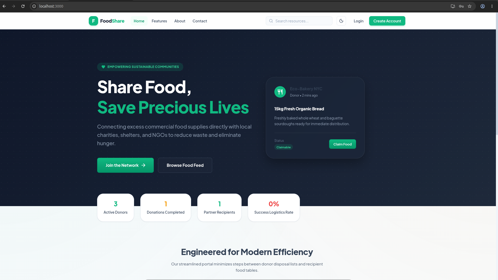
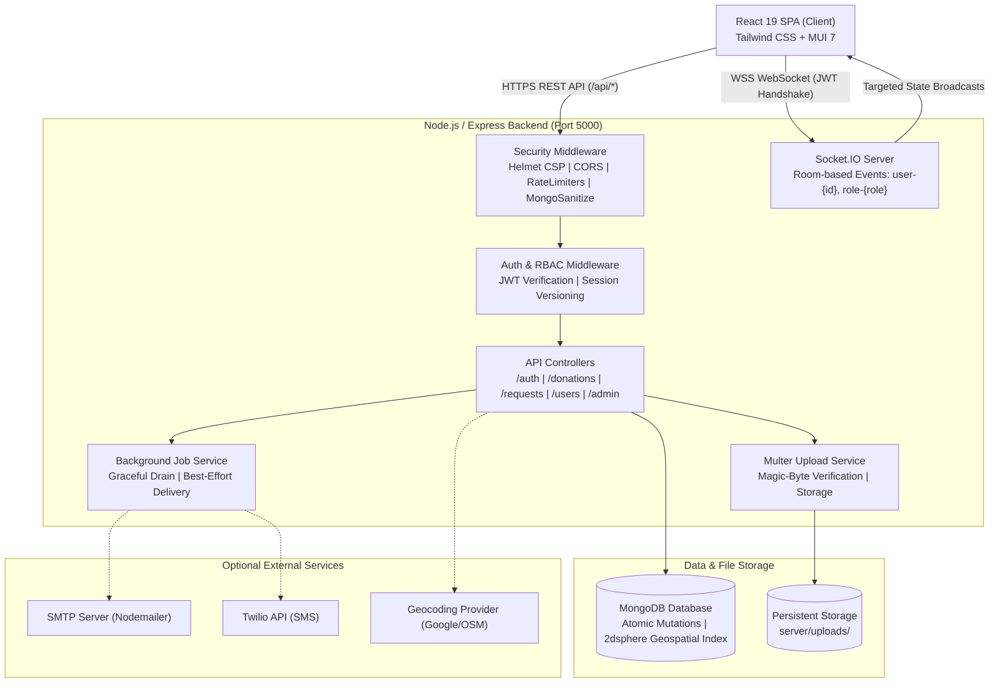

> **Implementation & Verification Status**: Current architecture, verified test results, and operational procedures are documented in the [Project Audit](docs/PROJECT_AUDIT.md), [Implementation Report](docs/IMPLEMENTATION_REPORT.md), and [Deployment Guide](docs/DEPLOYMENT.md).

# Food Distribution Platform (FoodShare)

A full-stack web application connecting commercial food donors (restaurants, bakeries, caterers, grocery stores) with local non-profits, shelters, soup kitchens, and community recipients. The platform orchestrates surplus food discovery, atomic reservation claiming, scheduled pickup coordination, and community food requests to eliminate edible food waste and alleviate local food insecurity.

---

## Table of Contents

- [Overview](#overview)
- [Key Features](#key-features)
- [Screenshots & Visuals](#screenshots--visuals)
- [Technology Stack](#technology-stack)
- [System Architecture](#system-architecture)
- [Repository Structure](#repository-structure)
- [Prerequisites](#prerequisites)
- [Installation & Local Setup](#installation--local-setup)
- [Environment Variables](#environment-variables)
- [Available Scripts](#available-scripts)
- [Testing & Quality Verification](#testing--quality-verification)
- [API Reference](#api-reference)
- [Security & Hardening](#security--hardening)
- [Docker & Production Deployment](#docker--production-deployment)
- [Known Limitations](#known-limitations)
- [Contributing](#contributing)
- [License & Acknowledgments](#license--acknowledgments)

---

## Overview

### The Problem
Commercial food establishments routinely produce edible, high-quality surplus food. Due to logistical barriers—unpredictable donation timing, lack of allergen safety metadata, communication overhead, and the risk of double-allocation—millions of tons of wholesome food are discarded into landfills, generating potent greenhouse gases while vulnerable community members experience food scarcity.

### The Solution
The **Food Distribution Platform** bridges this coordination gap with:
- **Verified Donor & Recipient Lifecycles**: Role-based portals tailored specifically for commercial food donors and verified community recipients.
- **Race-Condition-Free Reservation**: Atomic MongoDB operations ensuring that donations cannot be double-claimed or erroneously transitioned.
- **Transparent Scheduling & Safety**: Explicit pickup time windows, food category classification, and allergen disclosure.
- **Direct Participant Coordination**: Privacy-scoped contact disclosure revealing phone numbers and pickup details exclusively to confirmed participants.
- **Real-Time Notification Inbox**: Durable, authenticated in-app messaging paired with live WebSocket updates and optional email/SMS dispatches.

---

## Key Features

### 🍲 Donor Workflow
- **Comprehensive Listing Creation**: Specify food title, description, category (Cooked Meals, Bakery, Produce, Dairy, Canned Goods, Packaged), quantity with fractional support (minimum 0.1), units (servings, kg, lbs, items, boxes), allergens, preparation timestamp, expiry timestamp, and pickup window (start and end times).
- **Secure Image Uploads**: Multi-part image upload with MIME and magic-byte file signature validation to prevent malicious uploads.
- **Location & Geocoding**: Address input with automatic coordinate geocoding (via OpenStreetMap/Google Geocoding), with unmapped fallbacks rather than invented coordinates.
- **Conditional Listing Management**: Edit listing details or cancel listings safely with atomic concurrency controls (mutations are blocked once a recipient claims the donation).
- **Donor Analytics & History**: Dashboard tracking historical donation volume, completion rates, and status progression (`available` &rarr; `claimed` &rarr; `picked-up` &rarr; `completed`).

### 🤝 Recipient & Shelter Workflow
- **Searchable Food Feed**: Browse available food donations with real-time text search, category filtering, status filtering, and pagination.
- **Geospatial Radius Discovery**: Interactive map powered by Leaflet and OpenStreetMap displaying active donations with valid stored coordinates.
- **Atomic Reservation Claiming**: High-concurrency claim mechanism preventing race conditions between simultaneous claimants.
- **Pickup Coordination Board (`/volunteers`)**: Centralized coordination dashboard for recipients to review active claims, navigate to pickup locations, access donor contact details, and mark donations as physically picked up and completed.
- **Community Food Requests (`/requests`)**: Recipients and shelters can post specific community needs (title, quantity, urgency, location); donors can atomically commit supplies to fulfill open requests.

### 🛡️ Administrative Governance
- **Platform Telemetry (`/admin`)**: Real-time overview of active donors, active recipients, total listings, completed pickups, and aggregate platform success rates.
- **User Account Moderation**: Review paginated user profiles, search accounts, and toggle user active/inactive status with immediate session and socket revocation.
- **Donation Oversight**: Administrative search, full inspection, and listing deletion with automatic notifications dispatched to affected participants.
- **Scheduled Reminder Dispatch**: Trigger scheduled pickup reminders for claims approaching their designated collection window.
- **Operator-Only Provisioning**: Dedicated CLI command (`npm run admin:create`) ensures administrative accounts cannot be created via public self-registration.

### 🔔 Real-Time & Notification Services
- **Authenticated WebSocket Connections**: Socket.IO connections authenticated via JWT, placing users into secure private rooms (`user-<id>`) and role channels (`role-<role>`).
- **Durable Notification Inbox (`/notifications`)**: Persistent in-app notifications for claims, pickups, completions, cancellations, request commitments, and administrative removals with unread counts and 90-day retention.
- **Optional Email & SMS Dispatch**: Asynchronous email delivery via Nodemailer (SMTP) and SMS notifications via Twilio for listing broadcasts, claim updates, and pickup reminders.

### ⚠️ Honest Identification of Unsupported & Incomplete Features
In accordance with the repository's [Implementation Report](docs/IMPLEMENTATION_REPORT.md):
- **Independent Courier Dispatch & GPS Tracking**: Not implemented. The platform does not support third-party courier registration, background vetting, or simulated live GPS vehicle tracking. All logistics rely on direct participant pickup coordination (`/volunteers`).
- **Inactive User Marketing Campaigns**: `POST /api/admin/reminders/inactive-users` returns `501 Not Implemented`.
- **Public Password Reset Flow**: Forgotten password self-service recovery via email is not implemented. Password updates require an active authenticated session or operator-level database administration.
- **Automatic Distance-Filtered Email Alerts**: Recipient profile distance preferences are persisted, but automated geospatial radius filtering on new-listing email fan-out is not yet implemented (capped at 100 opted-in recipients per listing).

---

## Screenshots & Visuals

### Public Landing Page & Discovery Preview
The landing page provides marketing messaging, real-time public telemetry, and immediate access to the public donation feed.



### Additional Interface Views
> **TODO (Screenshots)**: The following high-resolution production captures will be added following upcoming visual asset audits:
> - `<!-- TODO: docs/images/donor-dashboard.png - Donor Listing & Analytics Portal -->`
> - `<!-- TODO: docs/images/recipient-map.png - Geospatial Leaflet Donation Discovery Map -->`
> - `<!-- TODO: docs/images/pickup-coordination.png - Participant Pickup & Status Tracking Board -->`
> - `<!-- TODO: docs/images/admin-panel.png - Administrator Platform Oversight & User Moderation -->`

---

## Technology Stack

| Layer | Technologies & Libraries | Purpose |
|---|---|---|
| **Frontend Framework** | React 19 (`19.1.1`), React DOM 19 (`19.1.1`) | Component-driven Single Page Application |
| **Routing & Navigation** | React Router DOM 7 (`7.7.1`) | Client-side routing with authenticated layout guards |
| **Styling & Design System** | Tailwind CSS 3 (`3.4.15`), Material-UI 7 (`7.3.1`) | Utility-first layouts, dark-mode glassmorphism, accessible components |
| **Animation & Micro-interactions** | Framer Motion (`12.40.0`) | Smooth layout transitions, modal animations, state indicators |
| **Mapping & Geospatial UI** | Leaflet (`1.9.4`), React-Leaflet (`5.0.0`) | Interactive maps and marker rendering (local CSS bundled) |
| **HTTP & Real-Time Client** | Axios (`1.11.0`), Socket.IO Client (`4.8.3`) | RESTful API requests, automatic token refresh queue, live socket events |
| **Date & Form Utilities** | date-fns (`2.30.0`), `@mui/x-date-pickers` (`7.29.4`) | Pickup window scheduling, ISO date formatting, and validation |
| **Backend Runtime** | Node.js (`>=22.13.0`), Express (`4.18.2`) | RESTful API server, static SPA serving, and middleware pipeline |
| **Database & ODM** | MongoDB, Mongoose (`7.5.0`) | Document storage, schema constraints, conditional queries, 2dsphere indexing |
| **Real-Time Engine** | Socket.IO (`4.7.2`) | Authenticated WebSocket server with scoped user/role rooms |
| **Authentication & Crypto** | JSON Web Tokens (`9.0.2`), bcryptjs (`2.4.3`) | Dual-token authentication (15m access / 7d refresh), bcrypt cost factor 12 |
| **Security & Protection** | Helmet (`7.0.0`), express-rate-limit (`6.10.0`), express-mongo-sanitize (`2.2.0`), express-validator (`7.0.1`) | CSP headers, brute-force auth rate limiting, NoSQL injection sanitization, schema validation |
| **Media Handling** | Multer (`2.4.0`) | Multipart file uploads with image signature (magic-byte) inspection |
| **External Integrations** | Nodemailer (`10.1.2`), Twilio (`4.15.0`), node-geocoder (`4.2.0`) | Asynchronous SMTP emails, SMS dispatch, and geocoding |
| **Testing Frameworks** | Jest (`30.5.2`), Supertest (`7.2.2`), mongodb-memory-server (`11.3.0`), React Testing Library (`16.3.0`) | In-memory integration testing, API contract tests, React component tests |
| **Containerization & CI** | Docker (multi-stage `node:22-bookworm-slim`), GitHub Actions | Containerized deployment and automated CI verification |

---

## System Architecture

### Client-Server Architecture & Data Flow



### Request Lifecycle & Concurrency Model
1. **Authentication**: Users authenticate via `POST /api/auth/login`. The server issues a short-lived 15-minute access JWT and a cryptographically hashed 7-day refresh token stored in the database with a unique JWT ID.
2. **Session Versioning**: Logouts, password changes, and administrator deactivations increment the user's `sessionVersion`, invalidating all active access and refresh tokens across all devices immediately.
3. **Atomic Claim Operations**: Listing claims use an atomic `Donation.findOneAndUpdate` with status preconditions (`status: 'available'`). Simultaneous requests by multiple recipients result in exactly one successful claim and an HTTP 400 rejection for conflicting attempts.
4. **Scheduled Lifecycles**: Donations follow a strictly enforced unidirectional state machine:
   $$\text{available} \longrightarrow \text{claimed} \longrightarrow \text{picked-up} \longrightarrow \text{completed}$$
   Listing cancellations are permitted only prior to physical pickup.

---

## Repository Structure

```
Food-Distribution-Platform/
├── .github/
│   └── workflows/
│       └── ci.yml                 # Automated CI workflow (Node 22, lint, test, build)
├── client/                        # Frontend React 19 application
│   ├── public/                    # HTML template, manifest, icons
│   ├── src/
│   │   ├── components/            # Reusable UI components (Navbar, Footer, Layouts, Chips)
│   │   ├── context/               # React Contexts (AuthContext, NotificationContext, TrackingContext)
│   │   ├── pages/                 # Route page components (Dashboard, Donations, Map, Requests, Admin)
│   │   ├── App.js                 # Application router and protected route wrappers
│   │   ├── config.js              # Environment-aware API and asset URL resolvers
│   │   └── setupTests.js          # Jest DOM testing configuration
│   ├── .env.example               # Client environment variable template
│   ├── package.json               # Client dependencies, scripts, and proxy settings
│   └── tailwind.config.js         # Tailwind utility styling configuration
├── docs/                          # Technical reports and operational guides
│   ├── DEPLOYMENT.md              # Detailed local, container, and production deployment guide
│   ├── IMPLEMENTATION_REPORT.md   # Complete architectural audit findings and remediations
│   ├── PROJECT_AUDIT.md           # Initial baseline risk assessment
│   └── verification/              # Empirical execution outputs and results.json
├── scripts/
│   └── create-admin.js            # Secure interactive CLI utility to provision administrator
├── server/                        # Express 4 backend application
│   ├── config/
│   │   └── security.js            # JWT signing secrets and crypto token verification
│   ├── middleware/                # Auth verification, rate limiting, and Multer upload
│   ├── models/                    # Mongoose schemas (Donation, User, FoodRequest, Notification)
│   ├── routes/                    # API route endpoints (auth, donations, requests, users, admin)
│   ├── services/                  # Background jobs, email service, notification service, SMS
│   ├── test/                      # Backend automated integration test suite (5 suites, 71 tests)
│   ├── utils/                     # Geocoding utilities
│   ├── uploads/                   # Local storage for uploaded donation photos (.gitkeep tracked)
│   └── index.js                   # Application entry point, Express server, and Socket.IO
├── .dockerignore                  # Docker build context exclusions
├── .env.example                   # Backend environment variable template
├── .gitignore                     # Comprehensive repository ignore rules
├── Dockerfile                     # Multi-stage container definition (node:22-bookworm-slim)
├── image.png                      # Verified landing page visual asset
├── LICENSE                        # MIT License (Copyright (c) 2025 Ankesh Singh)
├── package.json                   # Root manifest, workspace scripts, engine requirements
└── README.md                      # Project landing page and documentation
```

---

## Prerequisites

- **Node.js**: `v22.13.0` or higher (verified in `package.json` engines requirement).
- **npm**: `v10.0.0` or higher.
- **MongoDB**: `v7.0` or `v8.0` (local instance, containerized MongoDB, or MongoDB Atlas).
- **Docker** (optional): `v24.0+` for containerized verification.
- **Optional External Services**:
  - SMTP server credentials (e.g. Gmail App Password, SendGrid, Amazon SES) for email alerts.
  - Twilio account credentials (Account SID, Auth Token, Sender Phone) for SMS alerts.
  - Google Maps Geocoding API key for address coordinate resolution.

---

## Installation & Local Setup

### 1. Clone the Repository
```bash
git clone https://github.com/ankesh15/Food-Distribution-Platform.git
cd Food-Distribution-Platform
```

### 2. Install Dependencies
Install dependencies for both the root backend and client application:
```bash
# Install root backend dependencies
npm ci

# Install frontend client dependencies
npm ci --prefix client
```

### 3. Configure Environment Variables
Copy the sanitized environment template to create your local `.env`. Never overwrite an existing configuration:
```bash
# Preserve any existing .env; copy only if absent:
cp -n .env.example .env
```
Open `.env` in your text editor and supply your local MongoDB URI and development secrets. For development, default fallback values are provided for local execution.

### 4. Database Setup
Ensure MongoDB is running locally. If you use Docker, launch an isolated development instance:
```bash
docker run -d --name foodshare-local-mongo \
  -p 127.0.0.1:27017:27017 \
  -v foodshare-local-mongo:/data/db mongo:8.2
```

### 5. Provision Administrator Account (Optional)
Because public registration is strictly limited to `donor` and `recipient` roles, provision an initial administrator using the interactive CLI script:
```bash
npm run admin:create
```
Follow the terminal prompts to specify the administrator name, email, and password. The script hashes the password and securely inserts the account into the database.

### 6. Start the Development Servers
Run the full-stack development environment:
```bash
npm run dev
```
This invokes `concurrently` to run both services simultaneously:
- **Backend API**: Starts `node --watch server/index.js` on `http://localhost:5000` with Node's native file watcher.
- **Frontend Client**: Starts the React development server on `http://localhost:3000` (Create React App automatically proxies `/api` requests to port 5000).

### 7. Verified URLs
- **Frontend Portal**: `http://localhost:3000`
- **Backend API Root**: `http://localhost:5000/api`
- **Database Readiness Check**: `http://localhost:5000/api/health` (returns `200` with database status, or `503` if disconnected)
- **Process Liveness Probe**: `http://localhost:5000/api/live` (returns `200 {"status":"OK"}`)

---

## Environment Variables

### Backend Configuration (`.env`)
The backend uses `dotenv` to load configuration from the root `.env` file (loaded only in non-test environments).

| Variable Name | Required? | Default / Example | Sensitive? | Purpose & Description |
|---|---|---|---|---|
| `PORT` | Optional | `5000` | No | Port on which the Express server and Socket.IO listen. |
| `NODE_ENV` | Required | `development` | No | Execution environment (`development`, `test`, `production`). |
| `MONGODB_URI` | **Required** | `mongodb://127.0.0.1:27017/foodshare` | **Yes** | Connection string for MongoDB database, including database name. |
| `JWT_SECRET` | **Required** | Generated per process if unset in dev | **Yes** | Cryptographic secret for signing access tokens (min. 32 chars in production). |
| `JWT_REFRESH_SECRET` | **Required** | Generated per process if unset in dev | **Yes** | Cryptographic secret for refresh tokens (must be independent of `JWT_SECRET`). |
| `CLIENT_URL` | **Required (Prod)** | `http://localhost:3000` | No | Allowed CORS origin(s), comma-separated. Must use HTTPS in production. |
| `TRUST_PROXY_HOPS` | Optional | Unset | No | Integer from 1 to 5 indicating trusted reverse proxy hops for IP resolution. |
| `UPLOAD_DIR` | Optional | `server/uploads` | No | Persistent filesystem path for storing uploaded donation images. |
| `EMAIL_HOST` | Optional | `smtp.gmail.com` | No | SMTP host for outbound notification emails. |
| `EMAIL_PORT` | Optional | `587` | No | SMTP port (`587` for STARTTLS, `465` for SSL/TLS). |
| `EMAIL_USER` | Optional | `your_email@gmail.com` | **Yes** | SMTP username / authentication email. |
| `EMAIL_PASS` | Optional | `your_app_password` | **Yes** | SMTP password or third-party application token. |
| `TWILIO_ACCOUNT_SID` | Optional | Unset | **Yes** | Twilio Account SID for SMS dispatch. |
| `TWILIO_AUTH_TOKEN` | Optional | Unset | **Yes** | Twilio Auth Token for SMS dispatch. |
| `TWILIO_PHONE_NUMBER`| Optional | Unset | No | Twilio source phone number in E.164 format. |
| `GOOGLE_MAPS_API_KEY`| Optional | Unset | **Yes** | Google Maps API key for address geocoding. |

### Frontend Build Configuration (`client/.env`)
Client environment variables must begin with `REACT_APP_` and are embedded into the client bundle at build time.

| Variable Name | Required? | Default | Sensitive? | Purpose & Description |
|---|---|---|---|---|
| `REACT_APP_API_URL` | Optional | `/api` | **Public** | Base URL for API requests. Defaults to `/api` for same-origin proxy or production deployment. |
| `REACT_APP_SOCKET_URL` | Optional | Inferred from API URL | **Public** | Socket.IO server URL. In development without `REACT_APP_API_URL`, defaults to port 5000. |

> [!CAUTION]
> **Client-Side Variables Are Public**: Values defined in `client/.env` are bundled directly into public JavaScript assets and can be inspected by any visitor. Never place secrets, database URIs, or private API keys in `REACT_APP_*` variables.

---

## Available Scripts

### Root Scripts (`package.json`)
Run these commands from the repository root:

| Command | Action |
|---|---|
| `npm run dev` | Starts both backend server and frontend client concurrently in watch mode. |
| `npm run server` | Starts the Express server using Node's native watcher (`node --watch server/index.js`). |
| `npm run client` | Starts the React development server via `cd client && npm start`. |
| `npm run build` | Compiles the production React application bundle into `client/build/`. |
| `npm start` | Launches the production Express server (`node server/index.js`). |
| `npm test` | Runs the 5 backend integration test suites using Jest (`--runInBand --detectOpenHandles`). |
| `npm run test:client` | Runs frontend unit and workflow tests using React Testing Library (`--watchAll=false`). |
| `npm run test:all` | Executes both backend and frontend test suites sequentially. |
| `npm run lint` | Executes ESLint across the frontend source with zero warnings permitted (`--max-warnings=0`). |
| `npm run check:server` | Validates JavaScript syntax across all server and operator files using `node --check`. |
| `npm run admin:create` | Interactive CLI tool to provision an initial administrator account. |
| `npm run install-all` | Convenience command to run `npm install` in root and `client/`. |

### Client Scripts (`client/package.json`)
Run these commands within the `client/` directory:

| Command | Action |
|---|---|
| `npm start` | Starts the Webpack dev server on `http://localhost:3000`. |
| `npm run build` | Builds optimized production static files into `build/`. |
| `npm test` | Launches the interactive Jest test runner. |
| `npm run lint` | Runs ESLint on `src/` (`--max-warnings=0`). |
| `npm run eject` | Ejects Create React App configuration (irreversible). |

---

## Testing & Quality Verification

### Test Suites Architecture
The automated test infrastructure is isolated from production systems:
- **Zero Production Mutation**: Backend integration tests run against an in-memory database managed by `mongodb-memory-server`. They do not connect to `.env` or external networks.
- **External Mocking**: Outbound SMTP and Twilio integrations are disabled during tests.
- **Realistic Concurrency**: The test suite validates concurrent claims, edit-versus-claim collisions, pickup-versus-cancellation collisions, and refresh token replay attacks.

### Verified Test Results (16 October 2026 Audit)
As recorded in `docs/verification/results.json` and `docs/IMPLEMENTATION_REPORT.md`:

| Quality Check | Execution Command | Result | Details |
|---|---|---|---|
| **Backend Tests** | `npm test` | **71 / 71 Passed** | 5 suites (platform, auth, email safety, background jobs, configuration). |
| **Frontend Tests** | `npm run test:client` | **16 / 16 Passed** | 3 suites (route guards, auth context, claim & refresh workflows). |
| **Combined Tests**| `npm run test:all` | **87 / 87 Passed** | 100% test pass rate across all layers. |
| **Syntax Verification** | `npm run check:server` | **Passed** | Clean `node --check` syntax across all server and script files. |
| **Code Linting** | `npm run lint` | **Passed (0 warnings)** | ESLint passes with zero warnings or errors. |
| **Production Build** | `CI=true npm run build` | **Passed** | Successfully compiled bundle (~338.77 kB gzipped JavaScript). |
| **Docker Build** | `docker build -t foodshare:local .` | **Passed** | Multi-stage image built successfully with non-root runtime. |
| **Runtime Audit** | `npm audit --omit=dev` | **0 Vulnerabilities** | Zero known vulnerabilities across both backend and client runtime dependencies. |

> [!NOTE]
> **Development Tool Advisories**: Running `npm audit` without `--omit=dev` reports advisories originating in Create React App 5 and Jest development-time dependencies. Production runtime dependencies are completely clean. Do not run `npm audit fix --force`, as it introduces breaking downgrades.

---

## API Reference

All API routes are served under the `/api` prefix. Authenticated endpoints require a Bearer token in the `Authorization` header:
`Authorization: Bearer <access_token>`

### System Health & Public Telemetry
- `GET /api/health` — Database readiness probe. Returns `200 {"status":"OK","database":"connected"}` or `503 {"status":"degraded","database":"unavailable"}`.
- `GET /api/live` — Process liveness probe. Returns `200 {"status":"OK"}`.
- `GET /api/stats/public` — Aggregated public metrics (active donors, active recipients, total donations, completed count, success rate).

### Authentication (`/api/auth`)
- `POST /api/auth/register` — Register a new account (`role`: `donor` or `recipient`). Returns user profile, access token, and refresh token.
- `POST /api/auth/login` — Authenticate with email and password. Protected by brute-force rate limiter.
- `POST /api/auth/refresh` — Exchange a valid refresh token for a new access token and rotated refresh token.
- `POST /api/auth/logout` — Revoke stored refresh token and invalidate session.

### Donations (`/api/donations`)
- `GET /api/donations` — List available donations with query filters (`page`, `limit`, `category`, `status`, `search`, `lat`, `lng`, `distance`).
- `POST /api/donations` — Create a new donation listing (*Donor or Admin*). Validates cross-field dates and units.
- `POST /api/donations/upload` — Upload donation photo (*Authenticated*). Validates image file signatures and size.
- `GET /api/donations/:id` — Retrieve donation details. Public views omit claimant details and contact phone numbers.
- `PUT /api/donations/:id` — Update listing details (*Owner or Admin*). Blocked if listing is already claimed.
- `DELETE /api/donations/:id` — Delete donation (*Owner or Admin*). Dispatches notifications if claimed.
- `POST /api/donations/:id/claim` — Atomically claim an available donation (*Recipient or Admin*).
- `POST /api/donations/:id/pickup` — Mark donation as picked up (*Claimant, Owner, or Admin*). Requires active pickup window.
- `POST /api/donations/:id/complete` — Confirm final distribution completion (*Claimant or Admin*).
- `POST /api/donations/:id/cancel` — Cancel listing (*Owner or Admin*). Permitted only prior to physical pickup.

### User Profiles & Management (`/api/users`)
- `GET /api/users/profile` — Get authenticated user profile.
- `PUT /api/users/profile` — Update user profile details (whitelisted fields).
- `PUT /api/users/password` — Change password. Increments session version and revokes other active sessions.
- `GET /api/users/summary` — Full-history account metrics and six-month completion trends.
- `GET /api/users/pickups` — Paginated pickup coordination board for the user's active claims.
- `GET /api/users/donations` — Paginated history of donations created by the authenticated donor.
- `GET /api/users/claimed-donations` — Paginated history of donations claimed by the authenticated recipient.
- `GET /api/users/nearby-recipients` — Geospatial proximity query for recipients within radius (*Donor or Admin*).

### Community Requests (`/api/requests`)
- `GET /api/requests` — Paginated community food requests (*Authenticated*).
- `POST /api/requests` — Create a food request (*Recipient or Admin*).
- `POST /api/requests/:id/commit` — Atomically commit supplies to fulfill a request (*Donor or Admin*).
- `PATCH /api/requests/:id/status` — Confirm receipt or cancel request (*Request Owner or Admin*).

### Notifications (`/api/notifications`)
- `GET /api/notifications` — Retrieve the latest 100 owned notifications and total unread count.
- `PATCH /api/notifications/read-all` — Mark all owned notifications as read.
- `PATCH /api/notifications/:id/read` — Mark a single notification as read.
- `DELETE /api/notifications/:id` — Delete an owned notification.

### Administration (`/api/admin`)
- `GET /api/admin/stats` — Platform-wide telemetry, completion rates, and active user metrics (*Admin only*).
- `GET /api/admin/users` — Paginated user directory with role and status filters (*Admin only*).
- `GET /api/admin/users/:id` — Detailed user history and activity log (*Admin only*).
- `PATCH /api/admin/users/:id/status` — Activate or deactivate user account with session revocation (*Admin only*).
- `GET /api/admin/donations` — Paginated list of all platform donations (*Admin only*).
- `GET /api/admin/donations/:id` — Unabridged donation details (*Admin only*).
- `DELETE /api/admin/donations/:id` — Remove donation and notify participants (*Admin only*).
- `POST /api/admin/reminders/pickup` — Manually trigger pickup window reminders (*Admin only*).
- `POST /api/admin/reminders/inactive-users` — Returns `501 Not Implemented` (*Admin only*).

---

## Security & Hardening

The application incorporates defense-in-depth security principles:

1. **Dual-Token Authentication with Session Invalidation**:
   - Access tokens expire after 15 minutes.
   - Refresh tokens are cryptographically hashed using SHA-256 before storage in MongoDB.
   - Tokens include a unique `jti` (JWT ID) to detect replay attempts.
   - User models track `sessionVersion`. Any password change, account deactivation, or logout revokes all existing sessions across devices.
2. **Password Security**:
   - Hashed using `bcryptjs` with a cost factor of 12.
   - Enforces length requirements (8 to 72 characters) to prevent bcrypt truncation vulnerabilities.
3. **Role-Based Authorization & Resource Ownership**:
   - Middleware enforces strict boundaries: `requireDonor`, `requireRecipient`, `requireAdmin`.
   - Modifying or deleting donations verifies ownership on the server; administrators can moderate with audited participant notifications.
4. **Input Validation & Injection Defense**:
   - `express-mongo-sanitize` strips `$` and `.` prefixes from inputs to prevent NoSQL query injection.
   - Comprehensive request schemas validated via `express-validator`.
   - Search parameters escape special regex characters to prevent ReDoS (Regular Expression Denial of Service).
5. **Rate Limiting & DoS Mitigation**:
   - Dedicated authentication rate limiter: 30 failed attempts per 15-minute window for login, register, refresh, and password changes.
   - Global API rate limiter: 600 requests per 15 minutes in production (2,000 in development).
   - Strict body size limits: JSON payloads capped at 256 KB, URL-encoded bodies capped at 32 KB.
6. **Upload Hardening**:
   - File uploads inspect binary magic bytes to verify genuine image signatures (PNG, JPEG, WebP) rather than relying on file extensions or client-sent MIME headers.
   - Uploaded files are assigned random names and served with `Content-Security-Policy: default-src 'none'`.
7. **HTTP Security Headers**:
   - `Helmet` configures strict Content Security Policy (CSP), frame denial (`frameAncestors: ["'none'"]`), and object restriction.
   - `X-Powered-By` header is disabled.
   - CORS enforces strict origin checking against `CLIENT_URL`.

---

## Docker & Production Deployment

### Docker Containerization
The repository includes a production-ready, multi-stage `Dockerfile`:
- **Stage 1 (client-build)**: Compiles the React frontend using `node:22-bookworm-slim`.
- **Stage 2 (runtime)**: Copies compiled assets, installs production-only backend dependencies (`--omit=dev`), runs as an unprivileged `node` user, and includes a built-in container health check.

```bash
# 1. Build the production image locally
docker build -t foodshare:local .

# 2. Run the container with persistent uploads and environment variables
docker run -d \
  --name foodshare-app \
  -p 5000:5000 \
  --env-file .env \
  -v foodshare-uploads:/app/server/uploads \
  foodshare:local
```

### Production Deployment Checklist
Before taking the platform live, consult [docs/DEPLOYMENT.md](docs/DEPLOYMENT.md) and ensure:
- [ ] **Database**: An authenticated, managed MongoDB cluster (e.g. MongoDB Atlas) configured with network access controls, automated backups, and TLS.
- [ ] **Cryptographic Secrets**: Independent, cryptographically generated secrets of at least 32 characters for `JWT_SECRET` and `JWT_REFRESH_SECRET`.
- [ ] **CORS & Origins**: Explicit HTTPS URLs configured in `CLIENT_URL` (no wildcards).
- [ ] **Reverse Proxy**: A TLS-terminating reverse proxy (Nginx, Traefik, Caddy, or Cloudflare) configured to forward WebSocket upgrades (`Upgrade: websocket`) to port 5000.
- [ ] **Persistent Storage**: Persistent volume mounted at `/app/server/uploads` or configured via `UPLOAD_DIR`.
- [ ] **Reverse Proxy Hops**: Set `TRUST_PROXY_HOPS` to the exact integer number of proxy hops if running behind a trusted load balancer.
- [ ] **Administrator Seed**: Run `npm run admin:create` once to configure the primary platform administrator.

---

## Known Limitations

For complete architectural details, review the [Implementation Report](docs/IMPLEMENTATION_REPORT.md):
- **Courier & Route Logistics**: There is no independent volunteer courier role or real-time GPS routing. All fulfillment is coordinated directly between donors and recipients.
- **Asynchronous Outbox**: Outbound email and SMS notifications operate on a best-effort asynchronous dispatch model following database transactions. High-volume deployments should introduce a persistent job queue (e.g., BullMQ / Redis) for guaranteed delivery.
- **Single-Process State**: In-memory rate limiting and Socket.IO rooms operate per Node.js process. Multi-instance horizontal scaling requires a Redis adapter for Socket.IO and a shared rate-limiting store.
- **Client Token Storage**: Refresh tokens are stored in browser `localStorage` for compatibility with the current frontend architecture. A migration to secure, `httpOnly`, `SameSite` cookies is planned.
- **Geocoding Fallback**: In the absence of a configured `GOOGLE_MAPS_API_KEY`, unknown addresses remain unmapped rather than receiving synthetic coordinates.

---

## Contributing

Contributions, bug reports, and pull requests are welcome. To contribute:

1. **Fork the Repository** on GitHub.
2. **Create a Feature Branch**:
   ```bash
   git checkout -b feature/your-feature-name
   ```
3. **Implement Changes**: Adhere to existing code conventions, preserve error-handling patterns, and keep modules focused.
4. **Execute Verification Checks**:
   ```bash
   # Run server syntax check
   npm run check:server

   # Run frontend linter (zero warnings required)
   npm run lint

   # Run backend integration tests
   npm test

   # Run frontend tests
   npm run test:client

   # Verify production bundle compilation
   npm run build
   ```
5. **Commit Your Changes**: Write concise, descriptive commit messages.
6. **Push and Open a Pull Request**: Submit your pull request against the `main` branch with a clear description of the problem solved.

---

## License & Acknowledgments

### License
This project is licensed under the **MIT License** — see the [LICENSE](LICENSE) file for complete terms and copyright details.

### Acknowledgments
- [Material-UI (MUI)](https://mui.com/) for theme baselines, icons, and accessible date pickers.
- [Tailwind CSS](https://tailwindcss.com/) for responsive utility layouts and styling.
- [React](https://react.dev/) & [Express](https://expressjs.com/) communities for robust full-stack ecosystems.
- [Leaflet](https://leafletjs.com/) & [OpenStreetMap](https://www.openstreetmap.org/) for open-source mapping.
- [Framer Motion](https://www.framer.com/motion/) for declarative animations.
